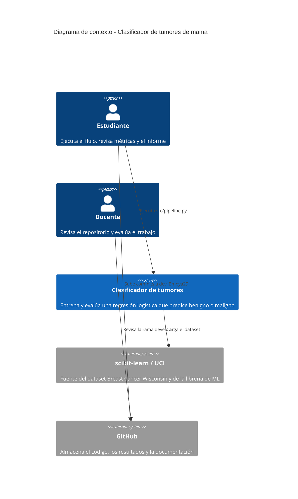
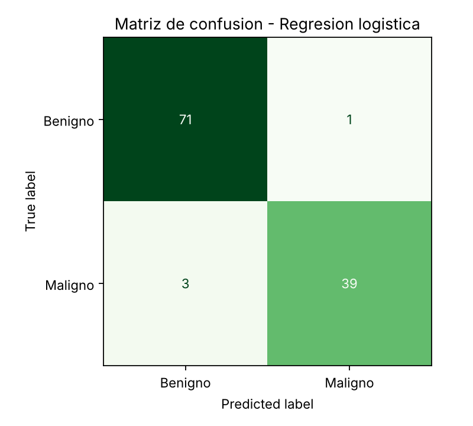

# proyectoFinal_diagnostico_cancer

Mini-proyecto individual de Machine Learning: clasificación de tumores de mama como **benignos** o **malignos** con regresión logística, evaluación con métricas cuantitativas y análisis ético.

Autor: Bmoya29 · Rama de trabajo: `dev_Bmoya29` · Rama de consolidación: `develop`

## Problema que se resuelve

Dado un conjunto de medidas numéricas tomadas sobre imágenes de una biopsia con aguja fina, el sistema predice si el tumor es maligno o benigno. El objetivo académico es recorrer el flujo completo de ML (definir la tarea, recolectar datos, preparar la entrada, elegir modelo, entrenar, evaluar y usar el modelo con datos nuevos) y reflexionar sobre los riesgos de usar este tipo de modelos en salud.

Este proyecto es **educativo**. No es un dispositivo médico ni sustituye un diagnóstico profesional.

## Datos

- **Fuente:** dataset *Breast Cancer Wisconsin (Diagnostic)*, incluido en scikit-learn (`sklearn.datasets.load_breast_cancer`). Original del repositorio UCI Machine Learning.
- **Tamaño:** 569 muestras y 30 variables numéricas.
- **Variables:** para cada núcleo celular se calculan 10 características (radio, textura, perímetro, área, suavidad, compacidad, concavidad, puntos cóncavos, simetría y dimensión fractal) y de cada una se reporta la media, el error estándar y el peor valor, lo que da 30 columnas.
- **Objetivo:** clase del tumor. En este proyecto la clase positiva (1) es **maligno** (212 casos, 37,26 %) y la negativa (0) es **benigno** (357 casos).

## Qué hace y qué no hace el sistema

Hace:

- Carga los datos, los separa en entrenamiento y prueba y escala las variables.
- Entrena una regresión logística y un modelo de referencia.
- Calcula accuracy, precision, recall y F1, y genera la matriz de confusión.
- Guarda el modelo entrenado y muestra predicciones sobre casos nuevos.

No hace:

- No diagnostica pacientes reales ni se conecta a historias clínicas.
- No procesa imágenes: trabaja con medidas ya extraídas.
- No ofrece interfaz web ni despliegue en producción.
- No explica casos individuales más allá de los coeficientes globales del modelo.

## Diagrama C4 de contexto



## Cómo funciona la solución

1. **Definir la tarea:** clasificación binaria (maligno vs. benigno).
2. **Recolectar datos:** carga del dataset desde scikit-learn y copia en `datos/breast_cancer.csv`.
3. **Representar la entrada:** estandarización de las 30 variables (media 0, desviación 1).
4. **Elegir el modelo:** regresión logística.
5. **Entrenar:** 80 % de los datos (455 muestras), separación estratificada.
6. **Evaluar:** 20 % restante (114 muestras) más validación cruzada de 5 particiones.
7. **Usar con datos nuevos:** el modelo se guarda en `modelos/` y se aplica a casos de prueba, devolviendo la probabilidad de malignidad.

## Estructura del repositorio

```
proyectoFinal_diagnostico_cancer/
├── README.md
├── requirements.txt
├── src/pipeline.py            # flujo completo de ML
├── datos/breast_cancer.csv    # copia local del dataset
├── modelos/                   # modelo entrenado (.joblib)
├── resultados/                # métricas, figuras y ejemplos de predicción
└── docs/informe.pdf           # informe con análisis ético y conclusiones
```

## Cómo ejecutarlo

```bash
pip install -r requirements.txt
python src/pipeline.py
```

El script imprime las métricas y escribe los resultados en `resultados/`.

## Decisiones de arquitectura (ADR)

### ADR-1: Enfoque de implementación con un único script y Pipeline de scikit-learn

- **Contexto:** el proyecto es individual y pequeño, y debe mostrar el workflow completo de ML de forma clara.
- **Decisión:** implementar todo en `src/pipeline.py`, usando un `Pipeline` que encadena escalado y modelo.
- **Justificación:** el Pipeline aprende el escalado solo con los datos de entrenamiento, lo que evita fuga de información hacia la prueba. Un solo script es fácil de ejecutar y de revisar.
- **Consecuencia:** menos modular que un paquete con varios módulos, pero suficiente para el alcance.

### ADR-2: Regresión logística como modelo, con DummyClassifier como referencia

- **Contexto:** hay que elegir un modelo sencillo y demostrar que aprende algo útil.
- **Decisión:** regresión logística, comparada con un `DummyClassifier` que siempre predice la clase mayoritaria.
- **Justificación:** la regresión logística es rápida, estable con 569 muestras, entrega probabilidades y sus coeficientes son interpretables, algo valioso en salud. El modelo de referencia fija el piso mínimo: acertar solo por la proporción de clases.
- **Alternativas descartadas:** árbol de decisión (más propenso a sobreajustar con pocos datos) y KNN (sensible a la escala y sin coeficientes que interpretar).

### ADR-3: Almacenamiento local y ejecución sin despliegue

- **Contexto:** el dataset pesa pocos kilobytes y el trabajo es académico.
- **Decisión:** guardar datos, modelo (`joblib`) y resultados como archivos dentro del repositorio, y ejecutar localmente.
- **Justificación:** no se requiere base de datos ni servidor. Versionar los archivos facilita que el docente reproduzca los resultados.
- **Consecuencia:** no hay servicio en línea. Si se quisiera usar en un entorno real habría que añadir una API, control de versiones del modelo y protección de datos.

## Calidad y evaluación del modelo

**Separación de datos:** 80 % entrenamiento y 20 % prueba, estratificada por clase y con semilla fija (42). El conjunto de prueba no se usa para ajustar nada. Además se hace validación cruzada estratificada de 5 particiones sobre el entrenamiento.

**Resultados sobre el conjunto de prueba (114 muestras):**

| Métrica | Modelo de referencia | Regresión logística |
|---|---|---|
| Accuracy | 0,632 | 0,965 |
| Precision | 0,000 | 0,975 |
| Recall | 0,000 | 0,929 |
| F1-score | 0,000 | 0,951 |

Validación cruzada (F1, 5 particiones): media 0,964 con desviación 0,021.

**Matriz de confusión** (clase positiva = maligno):

| | Predicho benigno | Predicho maligno |
|---|---|---|
| Real benigno | 71 (VN) | 1 (FP) |
| Real maligno | 3 (FN) | 39 (VP) |



**Criterios de aceptación** (definidos para este proyecto):

- Accuracy en prueba mayor o igual a 0,95. **Cumple** (0,965).
- Recall de la clase maligna mayor o igual a 0,92, porque un falso negativo es el error más costoso. **Cumple** (0,929, aunque con margen estrecho).
- Superar claramente al modelo de referencia en F1. **Cumple** (0,951 frente a 0,000).
- El resultado debe ser reproducible con la semilla fija. **Cumple.**

Con solo 42 casos malignos en la prueba, un caso más o menos cambia el recall en más de dos puntos, por lo que estas cifras deben leerse como una estimación y no como una garantía.

## Riesgos técnicos

| # | Riesgo | Impacto | Mitigación |
|---|---|---|---|
| 1 | Datos insuficientes: solo 569 muestras y 42 malignos en prueba | Métricas con alta incertidumbre | Validación cruzada y reporte de la desviación; evitar afirmar precisión definitiva |
| 2 | Fuga de información entre conjuntos (por ejemplo, escalar antes de separar) | Métricas infladas | Pipeline que ajusta el escalado solo con entrenamiento; separación antes de cualquier transformación |
| 3 | Sobreajuste | Buen resultado en entrenamiento y mal desempeño con datos nuevos | Modelo simple, regularización por defecto y validación cruzada |
| 4 | Sesgo del dataset: datos de una sola institución y población no descrita | Menor desempeño en otras poblaciones o equipos de captura | Documentar la limitación y exigir validación externa antes de cualquier uso real |
| 5 | Falsos negativos en un contexto médico | Un tumor maligno clasificado como benigno retrasa el tratamiento | Vigilar el recall, ajustar el umbral de decisión y exigir revisión humana |
| 6 | Uso indebido como diagnóstico real | Daño al paciente | Declarar el carácter educativo y mantener a un profesional en la decisión |

## Glosario

- **Accuracy:** proporción de predicciones correctas sobre el total.
- **Precision:** de los casos que el modelo marcó como malignos, cuántos lo eran realmente.
- **Recall (sensibilidad):** de los casos malignos reales, cuántos detectó el modelo.
- **F1-score:** media armónica entre precision y recall.
- **Matriz de confusión:** tabla que cruza lo real con lo predicho.
- **Verdadero positivo (VP):** maligno predicho como maligno.
- **Falso positivo (FP):** benigno predicho como maligno.
- **Verdadero negativo (VN):** benigno predicho como benigno.
- **Falso negativo (FN):** maligno predicho como benigno.
- **Sobreajuste:** el modelo memoriza el entrenamiento y generaliza mal.
- **Fuga de información:** datos de prueba que influyen en el entrenamiento.
- **Validación cruzada:** evaluar el modelo en varias particiones distintas de los datos.
- **ADR:** registro de una decisión de arquitectura y su justificación.

## Referencias

- Wolberg, W. H., Street, W. N. y Mangasarian, O. L. *Breast Cancer Wisconsin (Diagnostic) Data Set*. UCI Machine Learning Repository. https://archive.ics.uci.edu
- scikit-learn: *Toy datasets* y documentación de `LogisticRegression`, `Pipeline` y métricas. https://scikit-learn.org/stable/
- Brown, S. *The C4 model for visualising software architecture*. https://c4model.com
- Nygard, M. *Documenting Architecture Decisions* (formato ADR).
